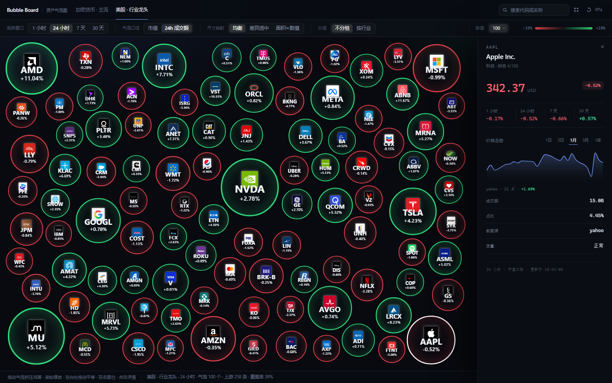

# Stock Bubble

一个仿 [cryptobubbles.net](https://cryptobubbles.net/zh) 的**多资产类别**气泡图行情看板：气泡面积默认代表 **24h 成交额**（也可切回市值），颜色代表涨跌幅，支持加密货币与美股，并且可以按行业分组、缩放平移、点开单只标的看走势。

后端 Python 3.12 + FastAPI，前端零构建（D3 v7 + 原生 JS），所有行情来自公开接口，无 API key 即可运行。

```
┌───────────────────────────────────────────────────────────────┐
│  topbar   加密货币 · 主流 | 美股 · 行业龙头          搜索 ⌕ ⟳  │
│  controls 涨跌窗口 1h 24h 7d 30d · 口径 24h成交额/市值 · 分组 … │
│  stage    ●●●●●●●●●  D3 pack 气泡图（缩放/平移/点击）          │
│  status   气泡 220 个 · 上游 220 条 · 覆盖率 100%   更新于 …    │
└───────────────────────────────────────────────────────────────┘
```


## 部署（Vercel）

整站被打包成**一个** Python 函数：`api/index.py` 复用 `stockbubble.api.asgi:app`，`vercel.json` 把 `src/ config/ web/` 一起塞进 bundle 并给 60s 超时。先在 GitHub 建仓库推上去，再到 Vercel「Add New → Project」导入即可（框架预设选 Other，不需要 build 命令）。

`api/index.py`、`vercel.json`、`requirements.txt`、`.vercelignore`、`scripts/check_vercel_entry.py` 都已就位；完整步骤、冷启动/静态资源取舍、常见报错见 [docs/deploy-vercel.md](docs/deploy-vercel.md)。

```bash
uv run python scripts/check_vercel_entry.py   # 部署前本地自检
```

## 快速开始

```bash
uv sync                     # 创建 .venv 并安装默认依赖（Yahoo 数据源，不含 OpenBB）
uv run stockbubble check    # 校验 universe 配置与装配（不打网络）
uv run stockbubble serve    # http://127.0.0.1:8000
uv run stockbubble snapshot us_equity --window 7d --limit 8   # 命令行看快照
```

> OpenBB 是可选的重依赖，需要时运行 `uv sync --extra openbb` 安装，再设置 `BUBBLE_US_PROVIDER=openbb`。Vercel 使用默认依赖，不安装这个 extra。
> 它只在美股报价主路径上起作用；把它关掉用 `BUBBLE_US_PROVIDER=yahoo`，
> 启动就没有这段开销（服务启动本身不 import OpenBB，是第一个美股请求才加载）。

开发模式（热重载 + 指定端口）：

```bash
uv run uvicorn stockbubble.api.asgi:app --reload --port 8077
```

质量门（四道，全部可在本地跑）：

```bash
uv run ruff check src tests && uv run ruff format --check src tests
uv run mypy                  # src + tests，42 个文件
uv run lint-imports          # 分层契约，见 .importlinter
uv run pytest                # 146 个用例，全部离线
```

## 架构

分层依赖**单向**：`api → application → adapters → domain`。用 `.importlinter`
（5 条契约）和 `tests/test_architecture.py`（AST 检查）双向锁死，改坏了 CI 就红。

| 层 | 职责 | 允许依赖 |
| --- | --- | --- |
| `domain` | 纯词汇表：`Universe`、`Quote`、`ChangeWindow`、`Snapshot`、错误类型、端口 Protocol | 只允许 pydantic |
| `adapters` | 外部世界：CoinGecko / Yahoo 行情、YAML universe 仓库、TTL 缓存、HTTP 客户端 | domain |
| `application` | 用例：`BubbleService`（快照）、`HistoryService`（走势）、`MarketFeed`（带缓存的取数）、`metrics`（气泡口径） | domain |
| `api` | 传输：DTO、路由、异常映射、静态资源 | application |
| `bootstrap` / `cli` | 组合根：唯一知道「真实适配器」的地方 | 全部 |

```
src/stockbubble/
  domain/        models.py  errors.py  ports.py
  adapters/      coingecko.py  yahoo.py  universes.py  cache.py  http.py  support.py
  application/   bubbles.py  history.py  feed.py  metrics.py  registry.py  services.py
  api/           app.py  routes.py  schemas.py  asgi.py
  bootstrap.py   config.py  cli.py
config/universes/*.yaml    数据驱动，加资产类别不用改代码
web/                       index.html  styles.css  app.js  vendor/d3.v7.min.js
tests/                     单元 + 适配器 mock + API 冒烟 + 架构守卫
```

### 为什么这样分层

- **端口用 Protocol 而不是基类**：`MarketDataProvider` / `PriceSeriesProvider` /
  `UniverseRepository` / `QuoteCache` 都是 `runtime_checkable` 的结构化协议，
  适配器和测试替身都不需要继承任何东西，`isinstance` 照样能校验。
- **组合根只有一个**：`bootstrap.build_services()` 是唯一 new 适配器的地方；
  `api` 拿到的永远是 `AppServices`，因此换数据源、加缓存、加代理都不动业务代码。
- **DTO 与领域模型分离**：`api/schemas.py` 决定线上 JSON 形状，领域模型可以自由重构。
- **失败要显式**：上游挂了不是 500，而是 `ProviderUnavailable`（503 +
  `hint`）；缺口用 `ProviderWarning` 和 `DataQuality`（ok/partial/stale）暴露到前端，
  用户看得到覆盖率，而不是被静默吞掉。

## HTTP 接口

| 方法 | 路径 | 说明 |
| --- | --- | --- |
| GET | `/api/config` | 前端启动配置：窗口、口径、刷新间隔、色标钳制 |
| GET | `/api/universes` | 可用 universe 列表（含窗口、limit、标的数） |
| GET | `/api/bubbles` | 气泡快照，参数 `universe`、`window`、`size`、`limit` |
| GET | `/api/history` | 详情走势，参数 `symbol`、`universe`、`timeframe` |
| GET | `/api/health` | 装配健康度：provider 能力、universe 数量 |
| GET | `/api/docs` | OpenAPI 文档 |

`/api/bubbles` 的每个 `nodes[]` 项：

```json
{
  "symbol": "BTC", "name": "Bitcoin", "asset_class": "crypto",
  "sector": "公链", "price": 75481, "currency": "USD", "change_pct": -6.37,
  "changes": {"1h": -0.4, "24h": -6.37, "7d": -3.1, "30d": 2.4},
  "size_value": 1.52e12, "share": 0.6709, "rank": 1,
  "quality": "ok", "source": "coingecko",
  "logo": "https://coin-images.coingecko.com/coins/images/1/large/bitcoin.png"
}
```

`logo` 由 provider 自报（目前只有 CoinGecko 有），缺失时为 `null`，前端自动降级为纯文字排版。

错误统一为：

```json
{"error": {"code": "unsupported_window", "message": "…", "hint": "allowed: 24h, 7d"}}
```

`code` 是稳定契约（`universe_not_found`、`unsupported_window`、`symbol_not_found`、
`provider_unavailable`…），前端按 `code` 分支，不解析文案。

## 扩展：加一个新的资产类别

以「港股」为例，**三步，零业务代码改动**：

1. **写 provider 适配器**（若已有可复用协议则跳过）：实现 `fetch_quotes()`，
   返回 `ProviderResult(quotes=..., warnings=...)`；需要走势则再实现 `fetch_series()`。
   声明 `provider_id`、`asset_class`、`supported_windows` 三个类属性即可。
2. **在组合根注册**：`src/stockbubble/bootstrap.py` 的 `build_providers()` 里
   `registry.register(YourProvider(...))`。
3. **加一个 YAML**：`config/universes/hk_equity.yaml`

```yaml
id: hk_equity
name: 港股 · 龙头
asset_class: us_equity      # 复用美股枚举，或用新枚举值
provider: yahoo
currency: HKD
default_window: 24h
supported_windows: [24h, 7d, 30d]
limit: 120
instruments:
  - {symbol: "0700", name: 腾讯控股, sector: 通信服务}
  - {symbol: "9988", name: 阿里巴巴, sector: 可选消费}
```

`bootstrap.validate_universes()` 会校验：provider 已注册、asset_class 与 provider 一致、
`supported_windows` 是 provider 能力的子集、静态 universe 必须写 instruments、
未知字段（`extra="forbid"`）直接报错。**配置写错就起不来，而不是线上少几个气泡。**

## 数据源说明（踩过的坑）

- **选型依据**：按 GitHub star 数查了一圈股票/金融类开源项目（2026-11 实测），
  **OpenBB 75,126 ★** 排第一，其后是 freqtrade 56,541（加密交易机器人）、
  microsoft/qlib 50,049、vn.py 46,250、akshare 23,237。因此美股报价层接的是
  `OpenBB Platform`（MIT，`obb.equity.price.quote(..., provider="nasdaq")`，免 key）。
- **为什么 OpenBB 默认关闭、用 Yahoo 批量源**（这是状态栏出现
  「OpenBB 冷却中 · 已切换到备用行情源」的全部原因）：
  1. OpenBB 的免费报价路由是「一个 symbol 两次 HTTP」（`quote/{sym}/info` +
     `quote/{sym}/summary`）。本机实测 20 只票 21.2s、约 **1s/只**，
     258 只就是 4 分钟量级 —— 60 秒刷新一次的看板撑不住。
  2. `api.nasdaq.com` 在 **TLS 握手层**就拒掉 aiohttp：同一 URL、同一 IP、同一组
     请求头，httpx 200 / aiohttp 403（返回 HTML「Access Denied」，于是每条 symbol
     都 JSON 解码失败 → 整条路由「没有返回任何报价」）。`patch_nasdaq_transport()`
     把这一层换成 httpx，OpenBB 的 query/model/transform 照旧，路由才真的能出数。
  3. `yfinance` 提供方现在要求 cookie+crumb，直接返回 0 行。
  所以默认 `BUBBLE_US_PROVIDER=yahoo`（批量、~5s 拿全 258 只，含 crumb 与 spark）。
  OpenBB 作为可选项保留：`BUBBLE_US_PROVIDER=openbb` 时价格走 OpenBB
  （`source=openbb`，`patch_nasdaq_transport()` 已让 nasdaq 路由出数），代价是
  **整轮 258 只约 4–5 分钟**（limit 只影响回传条数，不影响取数范围），且 nasdaq
  路由不带市值 —— 那些行会退回按 24h 成交额定气泡大小，并在状态栏标记。分片失败
  即熔断 300s 并回落到批量源。每条行情都带 `source` 字段（详情抽屉「数据源」一栏
  能看到 `openbb` 或 `yahoo`）。
- **美股公司图标**：Yahoo 不给 logo，所以 `adapters/logos.py` 用两个免 key 的 PNG 源拼覆盖率
  （2026-11 对 258 只逐一验证）：parqet 256/258、companiesmarketcap 256/258，
  **并集 258/258** —— 缺的 4 只各补一边（`FOXA`/`GOOGL` 只有 parqet，
  `KIM`/`MRSH` 只有 companiesmarketcap，后两者在 `FIRST_SOURCE` 里换了首选顺序）。
  解析是纯字符串拼接（不探测、不联网），一次下发 `logo` + `logo_fallback` 两个 URL：
  前端 `<image>` 的 `error` 事件先换兜底源，两个都失败才回到「代码 + 涨跌」两行排版。
  深色 logo 靠 `filter: drop-shadow(白色)` 描一圈，才在深色气泡上看清。
- **CoinGecko**：`/coins/markets` 一次最多 250 条，适配器最多翻 4 页；
  1h/24h/7d/30d 四个窗口一次拿全；按 `exclude` 过滤稳定币/包装币后再截断到 `limit`。
  `image` 字段就是气泡顶部那个图标。
- **Yahoo Finance**：必须带 cookie + `crumb`。`/v1/test/getcrumb` 对
  `Accept: application/json` 返回 **406**，所以适配器固定发送浏览器风格的头；
  `401/403` 时清空 crumb 重试一次。
- **`/v8/finance/spark` 单次最多 20 个 symbol**（超过直接 400），因此按 20 分批；
  某批失败只降级对应窗口为 `None` 并给 warning，不会让整张图失败。
- 美股 7d/30d 不是自然日：用 5 / 21 个交易日收盘价算，与行情软件口径一致；
  **1h 用 `range=1d&interval=5m` 的 12 根 5 分钟棒算**（美股四个窗口现在都支持，
  盘前盘后按交易所时段自然缺失）。

## 板块分类（对齐 TradingView 口径）

分类不是代码里写死的常量，而是 `config/universes/*.yaml` 里的 `sectors:` 映射 +
可选的 `fallback_sector`。改分类只改 YAML，不需要动任何 Python。

**美股 = Morningstar / TradingView 的 11 个板块**（258 只，每只都必填 `sector`）：

| 板块 | 数量 | 板块 | 数量 |
| --- | --- | --- | --- |
| 科技 | 32 | 工业 | 31 |
| 金融服务 | 30 | 医疗保健 | 29 |
| 周期性消费 | 29 | 通信服务 | 20 |
| 防御性消费 | 20 | 能源 | 18 |
| 基础材料 | 18 | 房地产 | 17 |
| 公用事业 | 18 | | |

**加密货币 = TradingView 的 17 个板块**（220 只，`sectors` 是 `SYMBOL: 板块` 映射，
不写就落到 `fallback_sector: 其他`，**不会有「未分类」**）：

第一层 / 第二层 / 比特币生态 / DeFi / 交易所 / Meme / AI / 游戏 / RWA / 稳定币 /
代币化股票 / 预言机 / 隐私 / 支付 / 存储 / 基础设施 / 其他

当前分布（市值口径、上游 220 只）：
DeFi 41 · 第一层 40 · 基础设施 21 · RWA 18 · Meme 18 · 其他 14 · 交易所 13 ·
AI 13 · 支付 8 · 第二层 8 · 游戏 8 · 隐私 7 · 代币化股票 5 · 预言机 2 · 存储 2 ·
比特币生态 2（稳定币全部在 `exclude` 里，所以通常不出现）。

加一种新币/新票只要在 YAML 里补一行：

```yaml
sectors:
  NEWCOIN: DeFi        # 加密
# 美股则写在 instruments 上
#   - { symbol: NEW, name: NewCo, sector: 科技 }
```

`tests/test_sectors.py` 守着这些口径：两个宇宙的板块集合必须与上面两个列表**完全相等**、
每只美股都有板块、加密未知代码必须落到 `fallback_sector`。

## 配置

环境变量前缀 `BUBBLE_`，也可写 `.env`：

| 变量 | 默认 | 说明 |
| --- | --- | --- |
| `BUBBLE_HOST` / `BUBBLE_PORT` | `127.0.0.1` / `8000` | 监听地址 |
| `BUBBLE_QUOTE_TTL_SECONDS` | `45` | 行情缓存；过期后单飞刷新，失败回退旧值并标 stale |
| `BUBBLE_SERIES_TTL_SECONDS` | `300` | 走势缓存 |
| `BUBBLE_MAX_NODES` | `400` | 单次快照最多渲染多少个气泡 |
| `BUBBLE_AUTO_REFRESH_SECONDS` | `60` | 前端自动刷新间隔 |
| `BUBBLE_COLOR_CLAMP_PCT` | `10` | 色标钳制：±10% 之外饱和 |
| `BUBBLE_COINGECKO_API_KEY` | 空 | 可选，走 demo key 提额 |
| `BUBBLE_US_PROVIDER` | `yahoo` | 美股报价路由：`yahoo`（批量，默认）或 `openbb`（逐只慢、需 transport 补丁） |
| `BUBBLE_OPENBB_QUOTE_PROVIDER` | `nasdaq` | OpenBB 内部提供方，也可 `yfinance`（易 429） |
| `BUBBLE_OPENBB_CHUNK_SIZE` | `60` | OpenBB 单次请求的 symbol 数 |
| `BUBBLE_OPENBB_CONCURRENCY` | `4` | 预留给并行分片（当前实现按顺序分片、首个失败即熔断） |

## 前端

零构建、零依赖（除本地 `vendor/d3.v7.min.js` 与 `vendor/planck.min.js`）：`fitFont` 按半径自适应标签字号（小气泡自动隐藏
文字），`d3.zoom` 提供滚轮缩放 / 空白处拖动平移 / 双击复位。URL 会同步
`universe/window/size/scale/group/limit/q/symbol`，链接可直接分享；`Esc` 关闭详情，
`/` 聚焦搜索。

### 布局：不分组时铺满整屏

`d3.pack` 只会把所有气泡套进一个圆，屏幕左右两侧会空出来。所以不分组视图换成
`rectLeaves()`：

1. **半径**按权重算：`r = k·√(size^(2p))`，`p` 由「目标半径比」反推（见下面的尺寸映射），
   `k` 由「气泡总面积 = 屏幕面积 × 0.52」反解，最大半径限制在短边的 26%、最小 10px。
2. **位置**用「最远点插入」：先在整屏抖动的网格上取候选点，最大的泡泡放正中，之后每颗
   都挑离已放置气泡最远的候选点（离边缘太近的大泡泡扣分），于是大泡泡散得开、小泡泡
   自然补缝。抖动用 `seededRandom()`（FNV-1a + LCG，种子是 universe/size/scale/symbol 列表），
   所以换个涨跌窗口不会整屏重排。
3. **松弛**：`relaxToRect()` 跑最多 90 轮两两分离（gap 6px），把剩下的重叠推掉并钳在边界内。

实测 120 颗时画布 4×4 网格每格 13–18 颗、横向跨度 1565/1570、纵向 751/758 —— 铺满整屏，
排版时几乎相切，运行时由位置式物理维持（见下面的气泡物理）。
「按行业」视图仍用 `d3.pack`（每个行业一袋 + 虚线环），因为那时需要的是结构而不是均布。

### 详情抽屉

点气泡后右侧滑出 352px 面板，内容是「身份 → 价格 → 四个窗口 → 走势 → 指标」一条竖线：

- 顶部 `AAPL / Apple Inc. / 科技 · 排名 4/100`，符号 10.5px mono 字距 0.2em，名称 17px；
- 价格 30px mono，当前窗口涨跌做成右侧 pill（`up` 绿 `down` 红，透明底 10%）；
- 四个窗口用一条上下细线夹住的四等分，不再是一张张卡片；
- 走势图 84px，时间范围是纯文字 tab（选中 1.5px 下划线），面积用 `#spark-fill` 渐变从 26% 淡到 0；
- 成交额 / 占比 / 数据源 / 质量 是 label 左、值右的定义列表，行间 1px 分割线；
- 底部一行 `24 小时 · 市值口径 · 更新于 10:42:06`，由 `stageSize()` 写进 `--bar-h` 保证抽屉与工具栏对齐；
- 抽屉打开时抑制悬浮 tooltip，避免它压住面板。



### 顶栏：一行导航 + 一行过滤器

两行各管一件事，视觉语言也分开，避免"一堆下划线"的噪音：

- **第一行（52px）**：品牌 + 资产类别 Tab（选中项 `2px` 强调色下划线）+ 搜索框 + 复位/刷新。
  Tab 是"去哪"，所以用下划线（导航语义）。
- **第二行（44px）**：涨跌窗口、气泡口径、尺寸映射、分组各是一组 **描边分段控件**
  （`1px rgba(255,255,255,.075)` 边框 + 圆角 8 + 内边距 2px），选中项是浅色实底
  （`rgba(255,255,255,.12)`）+ 白字；数值是"改什么"，所以用分段控件（选择语义）。
  组与组之间是 1px 竖线，标签 10.5px / `#4d5766`，值 12.5px，形成两级层次。
- **右侧聚类**：「数量」与色标图例 `margin-left: auto` 贴右，与前四组之间也有竖线分隔——
  左边是"筛选"，右边是"规模与读色"，扫视时不会混在一起。
- 数量触发器与分段控件同构（外描边 + 内实底），所以整行只有一个"chip"语言。

### 图标与数量：对齐 cryptobubbles 的两个细节

- **币种图标**：CoinGecko 的 `image` 字段落到 `Quote.logo_url` → `BubbleNode.logo_url` →
  `nodes[].logo`，前端画在气泡顶部（`image.logo`，`` 加载失败自动隐藏该图）。
  `r ≥ 18` 才显示图标，`logoSize = min(56, r × 0.58)`；有图标时代码在中间、涨幅在下方，
  没有图标（美股）时退回「代码 + 涨幅」两行，字号上限从 26 提到 34。
- **数量选择（弹窗）**：顶栏「数量 100 ⌄」是一个 212px 的小面板 —— 3 列无边框数字网格
  `20 / 50 / 100 / 200 / 全部 / +`，选中项只有一层 9% 白底，不描边、不上蓝。点 `+`
  原地换成一行输入框（回车或「确定」生效，Esc 退回网格），超出 `config.max_nodes`
  自动夹到上限并 toast。自定义过的数字写进 `localStorage`（key
  `bubbleboard.customLimits`，最多 4 个），下次打开直接点选 —— 相当于把常看的档位
  「钉」在页面上。当前值同步到 `limit` 参数（`0` 表示全部），默认 100 时不写 URL。

### 配色与字形：两种色相、玻璃质感的环

- **两种色相**：涨=绿 `#33e884`、跌=红 `#ff4a55`，中间不插值到蓝/紫/灰。幅度只决定
  亮度：`ringOf()` 把 `|change| / color_clamp_pct` 做 `^0.62` 缓动，再与暗端
  （绿 `#2a7d54` / 红 `#8c2b35`）按 `0.66 + 0.34 × eased` 插值 —— 所以 ±1% 也有颜色，
  ±10% 才到满亮度。数据缺失（例如某只票当天没有成交、窗口算不出来）才用中性灰。
- **内部近黑、内缘发光**：`defs` 里只建两个可复用的 `radialGradient`（`#core-up`、
  `#core-down`），从圆心到边缘的透明度是 `0.02 → 0.05 → 0.14 → 0.20`，即中间几乎全黑、
  贴着环内壁才亮起来，再用 `fill-opacity = 0.6 + 0.4 × 强度` 叠一层。这样看起来像
  一块「被环照亮的玻璃」，而不是一块实心色块。
- **环是亮的**：`stroke-width = clamp(1.8, 4, r × 0.045)`，光晕只有
  `1.6–5px / opacity 0.05–0.14`。宽光晕（3–12px）在缩略时是一圈糊掉的雾，已经去掉。
- **绘制顺序**：`selection.sort((a, b) => a.r - b.r)`，小圆先画、大圆后画，
  邻居的光晕不会渗进大圆内部。
- **字形**：代码 `font-weight 650`、字号 `min(34, 0.36r, 适配宽度)`；涨跌幅是中性色
  `rgba(228,235,246,0.76)`、`8–15px`、`tabular-nums`，`r ≥ 22`（有图标时 26）才显示。
  颜色交给环，文字只负责「读得清」，避免一圈彩色数字把画面搅乱。
- **尺寸映射默认「均衡」，而且按目标半径比反解**：三档分别是
  `均衡 ≈ 2.2 倍`、`差异适中 ≈ 4.2 倍`、`面积∝数值`（严格面积比例，BTC 会吃掉半屏）。
  前两档不是写死的指数，而是用当前快照的最大/最小市值反推出
  `半径 ∝ size^p` 里的 `p`（`p = ln(目标倍数) / ln(maxSize/minSize)`），所以
  **换资产类别时视觉差异一致**：加密 120 个（市值跨度上万倍）与美股 120 个（跨度二十几倍）
  都是同一种「大小差不多」的观感（实测 crypto 42–93px、美股 40–89px，比值都是 2.2）。
  要让大小严格反映市值，切「面积∝数值」即可。
- **间距**：不分组视图的填充率 `fill = 0.52`（100 颗时中位半径约 46px、最大 88px、相邻间距中位 10px）、最小半径 10px、布局松弛间距 14px —— 静止时球之间是留着空隙的，只有拖动或游动撞上时才会接触（详见上面的铺满整屏一节）；
  「按行业」视图的 `d3.pack()` 用 `padding(34 / 8)`。排版结果就是「几乎相切」的泡沫，
  运行时交给下面的位置式物理维持。

### 气泡物理（planck.js / Box2D）

布局只负责给出**初始**位置，运行时的位置与速度由 **planck.js 1.4**（Box2D 的 JavaScript
移植，MIT，本地打包在 `web/vendor/planck.min.js`，290KB）积分 —— Box2D 是游戏行业用了
十几年的 2D 刚体引擎，接触求解、堆叠稳定、动量传递都是引擎原生的：

- **刚体**：每颗气泡是一个圆形 `fixture`（`density 0.001`、`friction 0`、`restitution 0`、
  `fixedRotation`），质量为密度 × 面积，所以大球推小球时按真实质量比传递动量。
- **回位**：每步给刚体施加 `F = m·(k·Δx − c·v)` 的弹簧力（`SPRING_K 11`、`SPRING_C 6.4`，
  接近临界阻尼），目标位置 = 布局位置 + 自己的**游动偏移** —— 「回位」和「呼吸」共用一条
  弹簧，整张图不会漂，也不会弹回布局位。
- **碰撞**：由 Box2D 的顺序冲量求解器负责（`world.step(1/60, 5, 3)`：5 次速度迭代、
  3 次位置迭代）。拖动大球时小球被**推着滑开、带着惯性滚一小段**，不是瞬间让位；
  引擎的允许穿透（`linearSlop`）是 0.005 单位，实测 −0.01px，肉眼就是环相切。
- **互斥（谁也不能压着谁）**：冲量求解器是"软"的 —— 弹簧一直把球往锚点压，位置迭代
  只能把穿透压到一两像素。所以每步 `world.step()` 之后再跑一轮 `separateOverlaps()`：
  网格分桶找相邻对，沿着圆心连线做**纯位置投影**（按 `1/r²` 分配，大球让得少），
  `OVERLAP_PASSES 10` 轮、容差 `OVERLAP_TOLERANCE 0.2px`。投影里分两档：
  **真穿透**（`dist < r1+r2`）全量推开；**只是靠太近**（空隙 < `REST_GAP 9px`）按
  `REST_PUSH 0.22` 软推 —— 这样静止时每颗球周围都留着一圈暗色空气，不会"粘"成一团，
  又不会和回位弹簧互抢而抖。
- **拖动时也是实心的**：被抓住的那颗**也参与投影**，逆质量 `DRAG_INV_MASS 0.5`
  （0.5 = 让一半的路，邻居让另一半）。早期版本把它排除在外，结果拖动时能压着别人走、
  叠进去 30 多 px；现在把邻居推开的同时自己也会被顶回来一点，实测拖动全程最大重叠
  **−0.6px**（亚像素）、指针滞后中位 5px，松手 2.5s 后回到 7–8px 的空隙。
- **碰撞手感**：接触瞬间按接近速度把冲量还回去 —— `BOUNCE_RESTITUTION 0.68`、
  `BOUNCE_DAMPING 0.55`、低于 `BOUNCE_MIN_SPEED 55px/s` 不弹（避免静止时抖）、
  同一对球 `BOUNCE_COOLDOWN 180ms` 内只弹一次；被拖的那颗也吃 40% 反冲，拖起来像"顶到
  实心东西"。同时被撞的一侧会闪 220ms（`.bubble.is-hit`：环粗 4.4px、亮 1.32×），
  所以撞击既有位移也有可见反馈。
- **兜底钳位**：球特别大时（例如只显示 20 颗，半径 90–180px）四面墙之间塞不下，软求解器
  会把球从角落顶出去。每步最后 `clampToStage()` 把球心硬钳回
  `[r + 16, 尺寸 − r − 16]`，保证"设了 20 颗"就是真的 20 颗都在画布上。
- **拖动**：用 Box2D 的 `MouseJoint`（游戏里标准的拖拽关节）抓球 —— 关节有最大拉力
  （`DRAG_FORCE 20000` × 质量）和频率（`DRAG_FREQUENCY 10Hz`、阻尼比 `0.72`），
  球是被**拉**过去的，不是被瞬移过去的，所以不会把邻居一帧弹开（那正是早期"拖拽时气泡
  闪现"的根因）。按下时记下指针到球心的偏移 `sim.grab`，球心不会瞬移到指针下面。
  松手销毁关节、锚点落在球自己停下的地方，并保留 `THROW_SCALE 0.08` 的跟手速度
  （上限 `THROW_MAX 140px/s`）当"甩出去"的惯性。
- **`Settings.maxTranslation = 10`**：Box2D 默认每步最多移动 2 个单位；我们把 1 单位当 1px，
  于是 2 单位/步 = 120px/s 的硬上限 —— 不放开它，拖球会像拖铅球（实测滞后 186px）。
  放到 40px/步时指针最跟手（滞后 6.3px），但一步能冲进邻居 40px、投影来不及补；
  收到 10px/步后指针滞后 5px、拖动全程最大重叠 −0.6px，手感与互斥都成立。
- **渲染**：`paintSim()` 写的是 `el.style.transform = translate3d(...)`（配
  `will-change: transform` 走合成器），并用 `entry.paint` 缓存跳过没有变化的写入；
  光晕**不能**用 `mix-blend-mode` —— 每个气泡各自成层后混合基底被隔离，拖动时整颗会
  时亮时暗（闪烁），静态截图里也会"洗白"。
- **墙**：四周静态 `Box`，`restitution 0`，离画布边缘 16px —— 球不会被挤到边缘外被裁掉。
- **游动**：`WANDER_RADIUS 6px`、`WANDER_SPEED 0.2`（周期约 31s、切向约 1.2px/s）。
- **固定步长**：1/60s，单帧最多补 3 步，手感不随帧率变化。
- **点击与拖动的区分**：拖动起点到松手点位移 `< 5px` 视为点击（打开详情）。
- **复位**：顶栏网格按钮清 `layoutKey` → 重建世界、回到布局位置；换窗口/口径/分组/尺寸/数量
  也会重排，60s 自动刷新则保留你摆好的位置。
- **暂停与无障碍**：`document.hidden` 停 rAF；`prefers-reduced-motion` 时关掉游动（弹簧照旧回位）。
- **可调常量**：`SPRING_K`、`SPRING_C`、`WANDER_*`、`THROW_*`、`WALL_PADDING`，
  以及 `stepSim()` 里的 `world.step(dt, 速度迭代, 位置迭代)`，全在 `web/app.js` 的
  `/* physics */` 常量区。

**实测**（120 颗、Edge headless + CDP 直读 `style.transform`）：

| 指标 | 数值 |
| --- | --- |
| 静止时相邻间隙（100 颗） | 最小 5.2–7.1px、p25 9.5px、中位 **14.6px**、相切 0 对 |
| 静置单帧位移 | 最大 0.04px（不抖） |
| 拖动撞进人群 | 单次拖动触发 **21–30 次**撞击（同一对 180ms 内只弹一次） |
| 3 秒整体位移 | 中位 2.8px、最大 4.5px（游动幅度） |
| 指针滞后（拖动中） | 中位 5px、最大 7px |
| 拖动全程最大重叠 | **−0.6px**（亚像素；调参前 −32.9px） |
| 220 / 258 颗极限密度 | 最小间隙 8.5 / 8.3px、61 / 58fps |
| 邻居单帧位移（拖动中） | p95 8.6px、最大 19px（修复前 28.5 / 59.6 —— 那 59.6px 的跳变就是"闪现"） |
| 松手 2.5s 后 | 相切 0 对、最小间隙 5.2px（被推开的邻居自己回位） |
| 帧率 | headless 50–57fps（无 vsync；真机 60fps） |
| 控制台 | 0 error |
