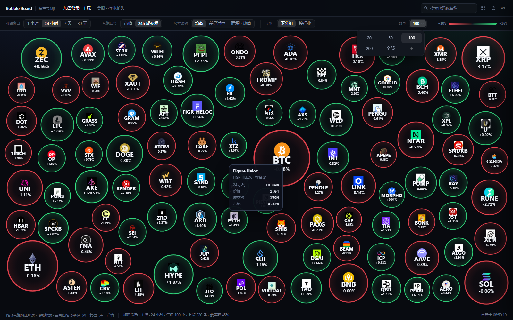

**在线体验：[Stock Bubble 网页版](https://stock-bubble-kappa.vercel.app/?universe=crypto&window=24h)**

# Stock Bubble

支持加密货币、美股、港股和沪深 A 股的气泡行情看板。气泡大小表示成交额或市值，绿色表示上涨，红色表示下跌 。

Python 3.12 + FastAPI，原生 JavaScript + D3 + planck.js，无需前端构建，默认无需 API Key。



## 功能

- 支持多时间窗口、行业分组、大小口径及显示数量设置。
- 搜索资产，查看价格、涨跌幅、走势图和市场涨跌比例。
- 支持缩放、拖动碰撞、移动端布局和分享筛选链接。
- 默认每 60 秒自动刷新，或点击“立即刷新”，成功后通过移动、碰撞随机重排；点击气泡、开关详情保留位置。

## 启动

安装 Python 3.12+ 和 `uv`，Windows 可直接双击 [start.bat](start.bat)，也可运行：

```bash
uv sync
uv run stockbubble serve
```

访问 `http://127.0.0.1:8000`，接口文档位于 `/api/docs`。开发热重载使用 `uv run stockbubble serve --reload`。

## 数据与配置

加密货币使用 CoinGecko，股票默认使用 Yahoo Finance。股票池与行业分类见 [config/universes](config/universes)，并非全市场。

标的按市值选取；切换成交额或市值只影响大小与占比。股票 `24h` 为最近交易日涨跌，`7d / 30d` 按 5 / 21 个交易日计算，成交额为估算值。行情延迟和覆盖范围取决于上游。

在 `.env` 中设置 `BUBBLE_` 环境变量，常用项：

```dotenv
BUBBLE_AUTO_REFRESH_SECONDS=60
BUBBLE_MAX_NODES=400
# BUBBLE_COINGECKO_API_KEY=你的DemoKey
```

完整配置见 [config.py](src/stockbubble/config.py)。可选美股 OpenBB 源需运行 `uv sync --extra openbb`，并设置 `BUBBLE_US_PROVIDER=openbb`。

## 部署与检查

Vercel 导入仓库时选择 **FastAPI**，根目录为仓库根目录，其余构建设置保持默认。详见 [部署说明](docs/deploy-vercel.md)。

```bash
uv run stockbubble check
uv run ruff check src tests
uv run ruff format --check src tests
uv run mypy
uv run lint-imports
uv run pytest
uv run python scripts/check_vercel_entry.py
```

浏览器回归检查：

```bash
uv run --with playwright playwright install chromium
uv run --script scripts/check_frontend.py
```
